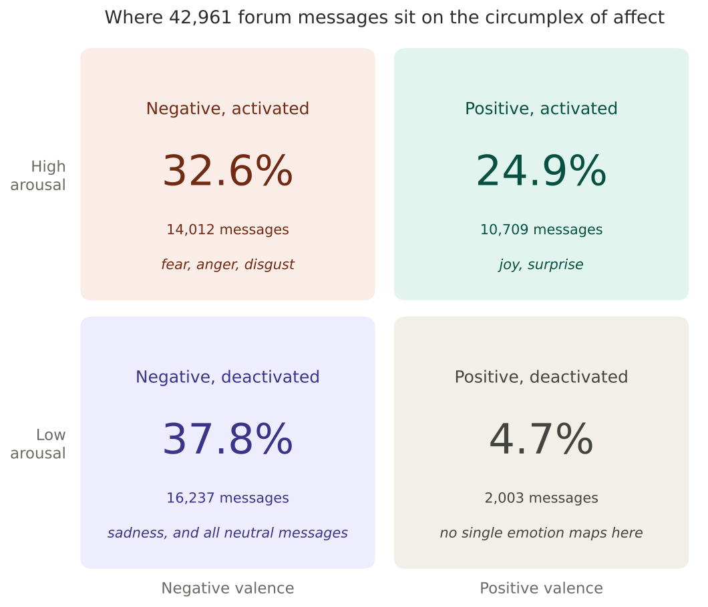
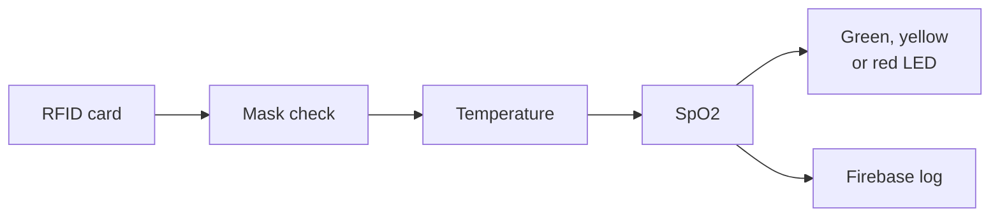

# Capstone projects

Two capstone projects. One reads 42,961 messages from the Beyond Blue mental-health forums to measure how people feel. The other is a Raspberry Pi gate that checked people for COVID-19 warning signs before letting them in. Each folder has its own detailed README with the method, results, limitations and run instructions.

| | [Emotional shifts on Beyond Blue](beyond-blue-emotional-shifts) | [IoT entry system with COVID-19 checks](iot-covid-entry-system) |
|---|---|---|
| Context | Master of Data Science, University of Adelaide (2025) | Team capstone project, built during the pandemic |
| Question | Where do forum messages sit emotionally, and do disasters change that? | Can a single gate identify people and screen them for symptoms without staff? |
| Data | 6,753 scraped threads, 76 Australian disaster declarations | Live sensor readings, RFID cards, camera frames |
| Methods | RoBERTa sentiment and emotion models, NRC-VAD mapping, circumplex of affect, lag-1 regression, interrupted time series | Embedded Python, MobileNetV2 mask classifier, I2C and SPI sensors, Firebase |
| Built with | Python, pandas, Hugging Face Transformers, statsmodels, Selenium | Raspberry Pi, OpenCV, TensorFlow, MLX90614, MAX30100, RC522 |
| Headline | 70% of messages are negative in tone; no evidence that disasters shifted it | Mask detection 99% accurate in our tests; every visit logged to Firebase |

## Emotional shifts on the Beyond Blue forums



I scored every message from four Beyond Blue boards with two pretrained transformer models, turned those scores into valence and arousal, and studied the result three ways: as a map of emotions, as week-to-week trajectories for individual posters, and against bushfires, floods and cyclones. The README is candid about what the data cannot show, including a time-series design that overstates its own results and a mapping choice that inflates one quadrant.

[Read the project →](beyond-blue-emotional-shifts)

## IoT entry system with COVID-19 symptom checks



A person taps a card, the camera checks for a mask, and infrared and pulse-oximeter sensors take a temperature and oxygen reading. The Pi turns those into a risk level, lights an LED and logs the visit to Firebase. The README covers the hardware, the risk rules, and the problems I would fix before anyone relied on it, including an oxygen reading that is not true SpO2.

[Read the project →](iot-covid-entry-system)

## Repository layout

```
Capstone_Projects
├── beyond-blue-emotional-shifts
│   ├── notebooks/        eight notebooks, scrape to disaster analysis
│   ├── data/             empty on GitHub; README lists every file and column
│   ├── figures/
│   ├── references.md
│   └── requirements.txt
└── iot-covid-entry-system
    ├── src/              Raspberry Pi code and model files
    ├── figures/
    ├── CREDITS.md
    └── requirements.txt
```

## A note on data and privacy

The Beyond Blue posts are public, but they are written by people at difficult moments. The forum data is not included here, and notebook outputs that showed usernames or the text of posts were removed before publishing. The IoT project's cloud settings live in a local `config.py` that git ignores, so no credentials are stored in this repository.

## Author

**Rubaiyat Alam Ruhin**  
[LinkedIn](https://linkedin.com/in/rubaiyatalamruhin) · [GitHub](https://github.com/ruhinb) · rubaiyatalam.ruhin@gmail.com
