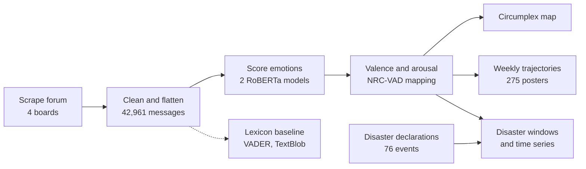
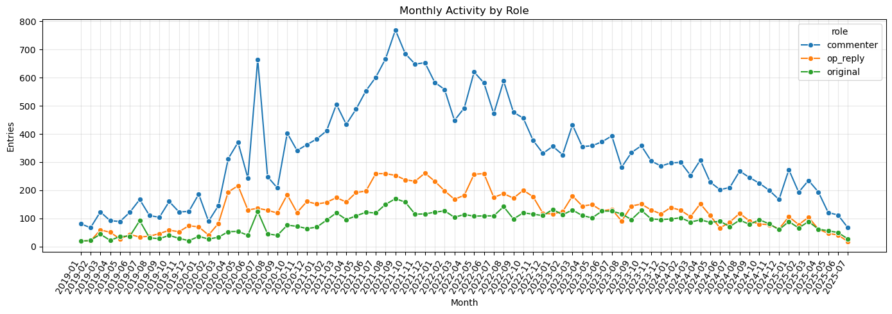
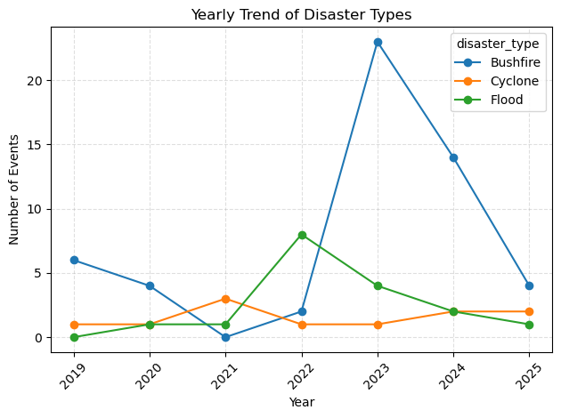
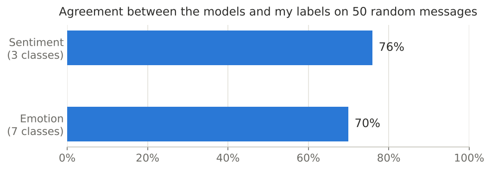
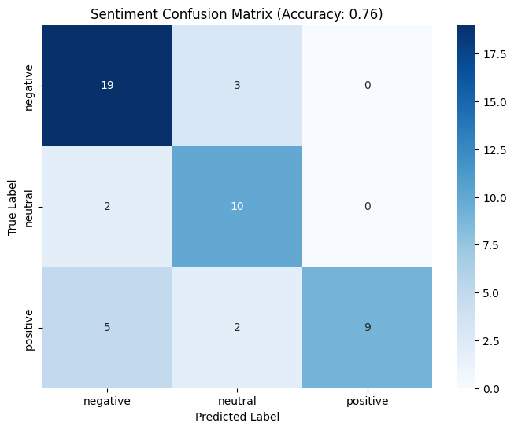
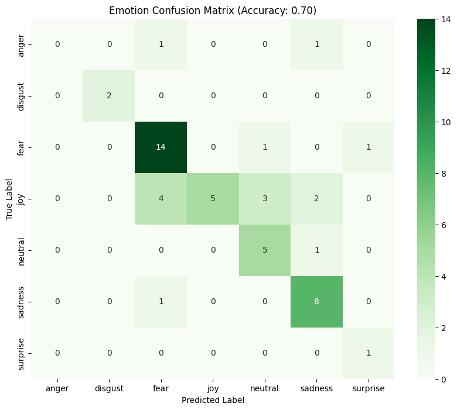
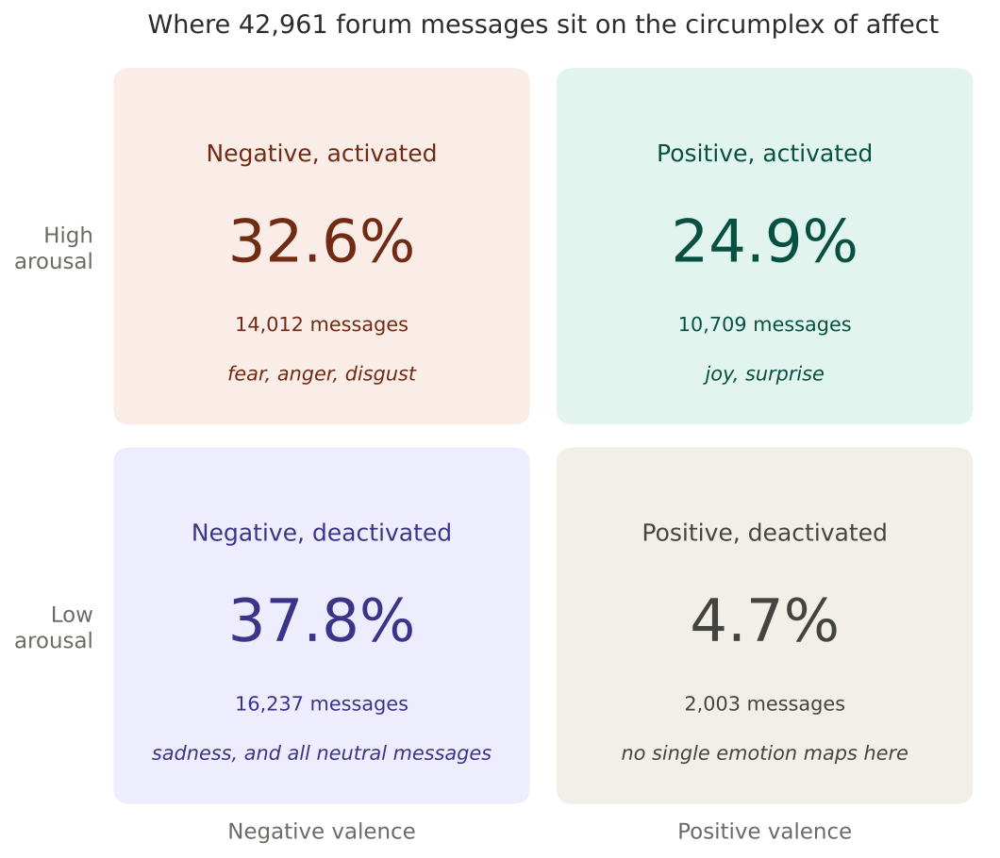
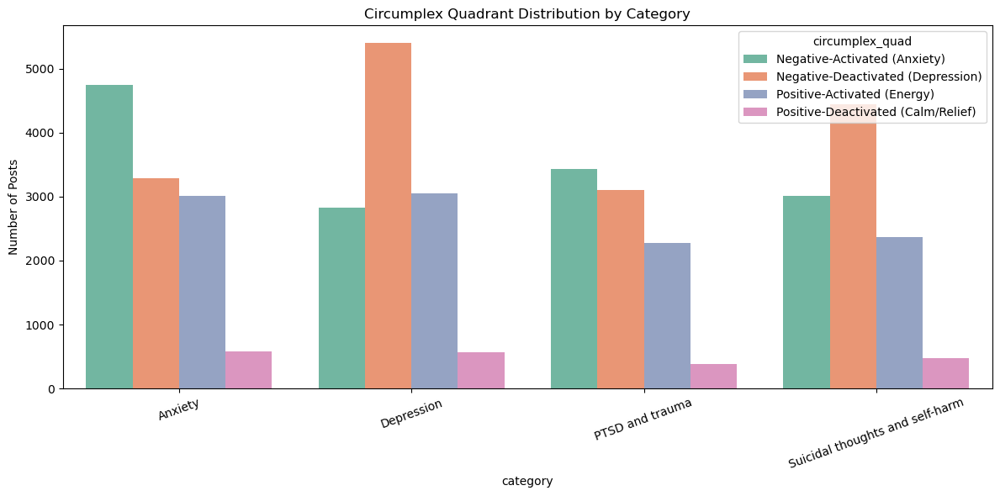
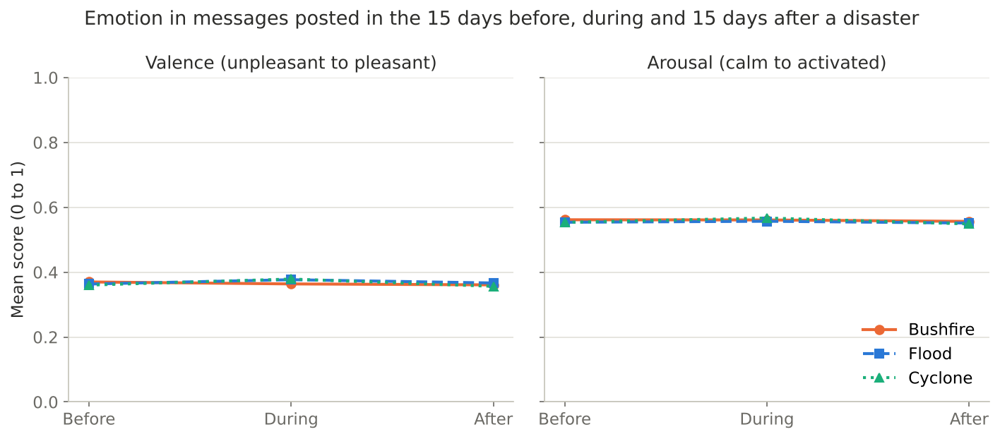
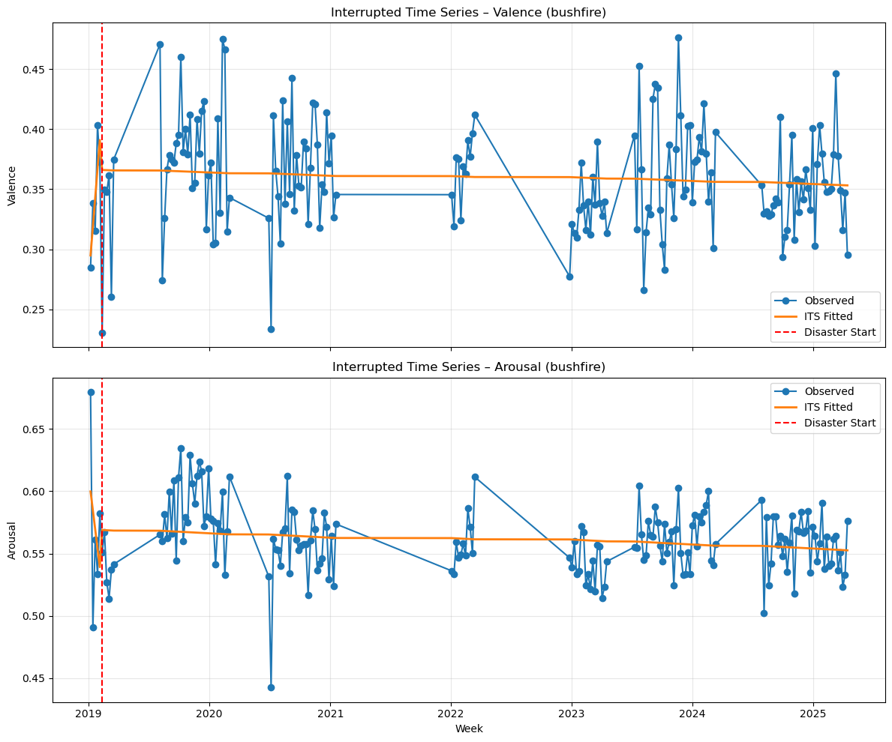

# Emotional shifts on the Beyond Blue forums

**Transformer emotion models, the circumplex of affect, and Australian natural disasters**

Master of Data Science capstone, University of Adelaide, 2025. Supervised by Indu Bala.

> This project analyses posts from mental-health support forums, including a board for suicidal thoughts and self-harm. If any of it affects you, Beyond Blue (1300 22 4636) and Lifeline (13 11 14) are available in Australia 24 hours a day.

People write to the Beyond Blue forums when they are struggling, and other members write back. I wanted to measure the emotional tone of that conversation at scale. Where do people's messages sit emotionally, does a person's tone change from week to week, and does a national disaster such as a bushfire season change how the forum feels?

I scraped 6,753 threads (42,961 messages) from four Beyond Blue boards, scored every message with two pretrained RoBERTa models, converted those scores into valence (unpleasant to pleasant) and arousal (calm to activated), and analysed the results three ways: as a map of emotions, as weekly trajectories for individual posters, and against 76 Australian bushfires, floods and cyclones.

| Threads | Messages | Forum boards | Period | Disaster events | Hand-checked messages |
|---:|---:|---:|---|---:|---:|
| 6,753 | 42,961 | 4 | Jan 2019 to Jul 2025 | 76 | 50 |

## Key findings

- **Most of the forum is negative in tone.** 70% of messages fall in the two negative quadrants of the circumplex: 37.8% low-arousal (sad, flat) and 32.6% high-arousal (anxious, angry). Part of the low-arousal share comes from how neutral messages are mapped, explained under [Limitations](#limitations).
- **Each board has its own emotional signature.** The anxiety board leans towards high-arousal negative messages. The depression and suicidal-thoughts boards lean towards low-arousal negative ones.
- **The models broadly agree with a human reader.** On 50 randomly chosen messages I labelled myself, the sentiment model matched me 76% of the time and the 7-class emotion model 70%.
- **A person's tone barely carries over from one week to the next.** For 275 people who posted in five or more different weeks, last week's mean valence explains about 2% of this week's (coefficient 0.15, R² 0.019).
- **I found no evidence that disasters shift the forum's emotional tone.** Mean valence moved by less than 0.025 (on a 0 to 1 scale) between the periods before, during and after bushfires, floods and cyclones. The time-series models did not find a clean break either, and the way I set them up overstates what they can show (see [Natural disasters](#6-natural-disasters)).

## How the analysis fits together



| Notebook | What it does | Main output |
|---|---|---|
| [`01_scrape_beyond_blue`](notebooks/01_scrape_beyond_blue.ipynb) | Collects threads and replies from four boards with Selenium and BeautifulSoup | `beyondblue_data.csv` |
| [`02_forum_eda`](notebooks/02_forum_eda.ipynb) | Cleans the posts, flattens each thread into one row per message and explores activity | `beyondblue_data_flattened.csv` |
| [`03_disaster_eda`](notebooks/03_disaster_eda.ipynb) | Cleans the disaster declarations and explores type, duration, state and season | `natural_disaster_data_cleaned.csv` |
| [`04_lexicon_baseline`](notebooks/04_lexicon_baseline.ipynb) | First attempt at valence and arousal with VADER and TextBlob | `..._lexicon_enriched.csv` |
| [`05_transformer_emotions`](notebooks/05_transformer_emotions.ipynb) | Scores every message with two RoBERTa models and checks them against my labels | `..._transformers_twitter_english_enriched.csv` |
| [`06_circumplex_model`](notebooks/06_circumplex_model.ipynb) | Places messages on the circumplex and counts each quadrant | Quadrant charts |
| [`07_emotional_trajectories`](notebooks/07_emotional_trajectories.ipynb) | Builds weekly valence for each original poster and fits a lag-1 regression | Regression summary |
| [`08_disaster_impact`](notebooks/08_disaster_impact.ipynb) | Lines messages up against disaster windows and fits interrupted time-series models | Phase comparison, ITS plots |

## Data

### Forum posts

The scraper visits the listing pages of four boards: anxiety, depression, PTSD and trauma, and suicidal thoughts and self-harm. For each thread it collects the title, the opening post, the author's username, the date and up to 40 replies, each with its own author and date.

Notebook 02 merges each thread's title with its opening post, converts emojis to words (for example "smiling face"), removes a few decorative symbols the converter missed, and then flattens the data so every message is one row. Each row gets a role: `original` for the opening post, `op_reply` when the original poster replies in their own thread, and `commenter` for everyone else.

| Board | Threads | Messages |
|---|---:|---:|
| Depression | 1,968 | 11,846 |
| Anxiety | 1,951 | 11,621 |
| Suicidal thoughts and self-harm | 1,445 | 10,292 |
| PTSD and trauma | 1,389 | 9,202 |
| **Total** | **6,753** | **42,961** |

Of the 42,961 messages, 6,753 are opening posts, 10,240 are replies by the original poster and 25,968 are from other members. Opening posts average about 1,200 characters, and the median thread has 3 replies.



### Natural disasters

The disaster table lists 350 Australian Government disaster declarations, each identified by its AGRN (Australian Government Reference Number), with start and end dates, state and hazard types. I cleaned it in notebook 03:

1. Standardised the hazard labels (including fixing "Earthquack" to "Earthquake").
2. Filled a missing end date with the start date for hazards that usually last a day, such as storms.
3. Dropped floods, bushfires and cyclones with missing dates, because their length matters.
4. Kept only bushfires, floods and cyclones, the long-running events most likely to affect how people feel.

That left 76 events from 2019 to 2025: 53 involving bushfire, 17 flood and 11 cyclone (5 events are both a flood and a cyclone). Bushfires lasted longest, about 20 days on average, against roughly 10 for floods and cyclones. Queensland (30 events) and New South Wales (29) account for most of them, and 2023 alone had 23 bushfire declarations.



### What is and isn't in this repository

The data files are not included. They contain forum usernames and the full text of people's posts about their mental health, and I don't think that belongs in a public repository even though the forum itself is public. For the same reason I removed every notebook output that showed a username or a passage of post text before publishing. Those cells now show a short note instead, and all charts and summary numbers are intact.

[`data/README.md`](data/README.md) lists every file the notebooks read and write, with its columns, so the pipeline can be rebuilt from a fresh scrape.

## Method and results

### 1. A lexicon baseline

My first attempt used rule-based tools. VADER gave each message a valence score from −1 to +1, and I built a rough arousal score from TextBlob subjectivity and intensity cues such as exclamation marks, capital letters and stretched words ("sooo").

VADER rated the median message +0.81, firmly positive, which doesn't fit a forum built around distress. Supportive replies are long and full of warm words ("welcome", "hope", "glad you reached out") that a word list scores as positive even when the subject is painful. The lexicon results stay in notebook 04 as a baseline, and the rest of the analysis uses transformer models instead.

### 2. Scoring emotions with transformers

Each message goes through two pretrained models from Hugging Face:

| Model | Output | Used for |
|---|---|---|
| [`cardiffnlp/twitter-roberta-base-sentiment-latest`](https://huggingface.co/cardiffnlp/twitter-roberta-base-sentiment-latest) | Probabilities for negative, neutral and positive | Sentiment valence (positive minus negative) |
| [`j-hartmann/emotion-english-roberta-large`](https://huggingface.co/j-hartmann/emotion-english-roberta-large) | Probabilities for 7 emotions | Valence and arousal through NRC-VAD |

To place a message on the circumplex, I take the emotion model's probabilities and average the valence and arousal of each emotion, weighted by its probability. The values come from the NRC Valence, Arousal and Dominance lexicon:

| Emotion | Valence | Arousal |
|---|---:|---:|
| Joy | 0.980 | 0.824 |
| Surprise | 0.875 | 0.875 |
| Neutral | 0.469 | 0.184 |
| Anger | 0.167 | 0.865 |
| Fear | 0.073 | 0.840 |
| Disgust | 0.052 | 0.775 |
| Sadness | 0.052 | 0.288 |

A message the model reads as 80% sadness and 20% fear lands at valence 0.056 and arousal 0.398: unpleasant and fairly low-energy. Messages longer than 512 tokens are cut off, which affects only the longest posts. Scoring all 42,961 messages took a GPU, so I ran this notebook on Google Colab.

### 3. Checking the models against a human reader

Pretrained models were built on other kinds of text (tweets and general English), so I checked them on this forum. I drew 50 random messages, labelled each one's sentiment and main emotion myself, and compared.



| | Agreement | Where it went wrong |
|---|---:|---|
| Sentiment (3 classes) | 76% | Caught 19 of 22 negative messages but only 9 of 16 positive ones. Five messages I read as positive, the model called negative. |
| Emotion (7 classes) | 70% | Fear and sadness were reliable. Joy was the weak spot: 4 of the 14 messages I labelled joy were read as fear. |

Many of the misses share a pattern. A supportive reply often restates the original poster's problem before offering encouragement, and the models pick up the distressing part. The models lean negative, so treat the share of negative messages as an upper estimate.

<p float="left">
  
  
</p>

### 4. The circumplex of affect

Russell's circumplex model places every emotion on two axes, valence and arousal. Splitting both at 0.5 gives four quadrants.



The quadrants also separate the boards. Anxiety-board messages are most often high-arousal and negative, which is what you'd expect from fear and worry. Depression and suicidal-thoughts messages are most often low-arousal and negative, the flat, heavy end of the scale. PTSD and trauma sits between the two.



### 5. Emotional trajectories

To see whether people's tone changes over time, I followed the original posters: their opening posts and their replies in their own threads. I averaged each person's valence by week and kept the 275 people with at least five active weeks, which gave 3,953 pairs of consecutive active weeks.

A lag-1 regression of this week's valence on the previous active week's gives:

| Term | Estimate | 95% CI |
|---|---:|---|
| Intercept | 0.286 | 0.274 to 0.299 |
| Previous week's valence | 0.153 | 0.119 to 0.188 |
| R² | 0.019 | |

The relationship is real but weak. A week of unusually positive or negative posts tells you little about the next, and people drift back towards an average valence of about 0.34. Weeks are "active weeks", so the gap between two of them can be months.

### 6. Natural disasters

I linked every message to each disaster within 30 days of it, giving 105,713 message and disaster pairs, and labelled each pair by phase: the 15 days before the start, during the event, or the 15 days after it ended. Pairs outside those windows are left out of the phase comparison.



On a 0 to 1 scale the lines are flat. The largest change is cyclones, where valence rises by 0.019 from before to during and falls by 0.022 afterwards. Grouping events by length (up to 3 days, up to 10, longer) gives changes of the same size.

I then fitted an interrupted time-series (ITS) model for each disaster type, with weekly mean valence and arousal as the outcome and terms for time, a step at the intervention and a change in slope after it.



*The red line marks the single intervention point the model uses: the first week of the earliest bushfire, in February 2019. Everything after it counts as "after the disaster".*

This design has a flaw I'd fix in a second version. It pools every event of a type into one series and uses only the earliest event's start as the intervention, so the "before" period is just a few weeks of early 2019. That is why the fitted slopes before and after are almost exact opposites (for bushfires, +0.024 and −0.024 per week). The coefficients are statistically significant, but they describe that one early break, not the effect of disasters in general.

Two more things dilute any real signal. Forum posts carry no location, so a post from Perth sits in the same window as a bushfire in New South Wales. And many messages fall near more than one disaster, so they are counted several times.

My conclusion is that, across the whole forum, there is no detectable disaster effect. That doesn't mean disasters don't affect people. It means this data, without location, can't show it.

## Limitations

- **Neutral messages are counted as depressive.** Neutral sits at valence 0.469 and arousal 0.184, just inside the low-arousal, negative quadrant. Every message the emotion model reads as neutral lands there, which inflates the 37.8%. No single emotion maps to the calm, positive quadrant, so it only fills with mixed scores. That explains its 4.7%.
- **The models lean negative.** Positive messages were the class they missed most (9 of 16 caught), and the human check covers only 50 messages labelled by one person.
- **The sample is not the whole forum.** The scraper read a fixed number of listing pages per board and up to 40 replies per thread, so long-running threads are cut short.
- **No location.** Posts can't be tied to the state where a disaster happened.
- **The ITS design** pools events and uses one intervention per disaster type, as described above.
- **Small differences in settings.** The full scoring run truncates at 512 tokens but the validation check used 256, so a few long validation messages were scored on less text than the main run.

## What I'd do next

1. Model each disaster separately, comparing posts in the event window with the same weeks in other years.
2. Reassign neutral messages, or use the models' raw valence and arousal regression heads instead of a 7-emotion lookup.
3. Label a larger, stratified validation sample with a second annotator and report agreement between the two of us.
4. Track how a thread's tone changes from the opening post to the last reply, which is closer to the forum's purpose than week-to-week change.

## Running the notebooks

```bash
pip install -r requirements.txt
cd notebooks
jupyter lab
```

Run the notebooks in order from inside `notebooks/`. They read and write `../data/`. Notebook 01 drives a real Chrome browser and takes hours for 800 listing pages, so please keep request rates low and respect the forum's terms if you re-scrape. Notebook 05 needs a GPU. On Google Colab, upload the data files and point the `../data/` paths at them.

## Ethics and privacy

- The forum is public, but the people writing on it are vulnerable and did not post for research. I treated the text accordingly.
- No data files, usernames or passages of post text are published here.
- Every chart shows aggregates only.
- Nothing in this project tries to identify a person or make predictions about any individual.

## Sources

The papers that shaped the method, and the models and datasets it uses, are listed in [`references.md`](references.md).

## Author

**Rubaiyat Alam Ruhin**, Master of Data Science, University of Adelaide  
[LinkedIn](https://linkedin.com/in/rubaiyatalamruhin) · [GitHub](https://github.com/ruhinb) · rubaiyatalam.ruhin@gmail.com
