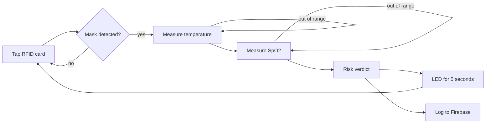
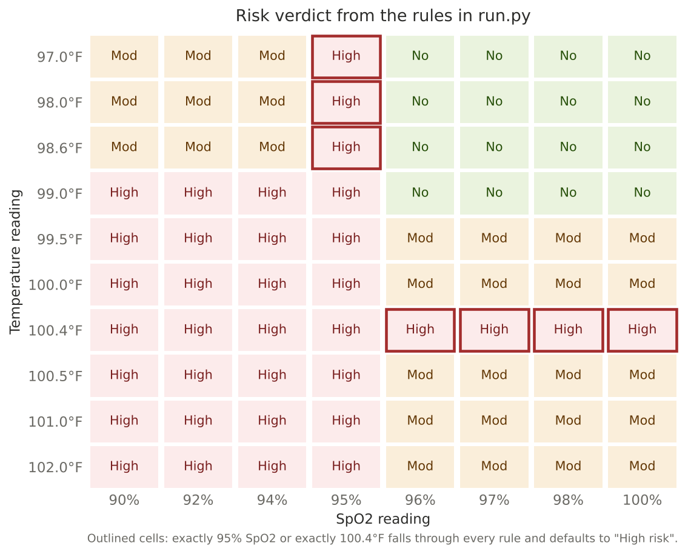

# IoT entry system with COVID-19 symptom checks

A Raspberry Pi entry gate that checks people for common COVID-19 warning signs before they walk into a workplace or classroom. Each person taps an ID card, is checked for a face mask by camera, then has their temperature and blood-oxygen level measured. The gate lights a green, yellow or red LED and logs the visit to a cloud database.

A team capstone project, built during the COVID-19 pandemic.

## Why we built it

When we started, the pandemic was in its early stages and many people were carrying the virus without knowing it. We wanted something that would make daily symptom checks routine for anyone arriving at work or university, and that would double as the entry system so nobody could skip it.

Our objectives were to:

1. Identify each person with an RFID card.
2. Check automatically whether they are wearing a mask.
3. Measure temperature and oxygen saturation without staff involvement.
4. Store every check in a database that can be monitored remotely.

## How a check works



1. **Card.** The RC522 reader reads the card's ID and the name written on it.
2. **Mask.** The camera runs for 10 seconds. A face detector finds faces and a MobileNetV2 classifier labels each one "Mask" or "No mask". If the result is no mask, or no face was seen, the gate goes back to waiting for a card.
3. **Temperature.** The MLX90614 infrared sensor reads the fingertip and converts it to °F. A reading outside 95 to 108°F flashes the blue LED and asks the person to try again.
4. **Oxygen.** The MAX30100 sensor samples for 15 seconds. A reading outside 90 to 100 flashes blue and repeats.
5. **Verdict.** The two readings are combined into a risk level, shown on the LEDs for 5 seconds and uploaded with the date and time.

## Hardware

| Part | Role | Connection (from the code) |
|---|---|---|
| Raspberry Pi | Runs everything | |
| RC522 RFID reader | Identifies the person | SPI, through the `mfrc522` library |
| Camera (USB or Pi camera) | Mask check | Video device 0 |
| MLX90614 infrared thermometer | Contact-free temperature | I2C at 100 kHz |
| MAX30100 pulse oximeter | Oxygen saturation | I2C, address 0x57 |
| Green, yellow, red, blue LEDs | Verdict and "try again" | GPIO 12, 16, 20, 21 (BCM numbering) |

## The risk rules

The verdict comes from fixed thresholds in [`src/run.py`](src/run.py):

| Verdict | LED | Condition |
|---|---|---|
| No risk | Green | Temperature at or below 99°F and SpO2 above 95% |
| Moderate risk | Yellow | Temperature between 99 and 100.4°F with SpO2 above 95%, or temperature above 100.4°F with SpO2 above 95%, or temperature below 99°F with SpO2 below 95% |
| High risk | Red | Everything else, which in practice means low oxygen together with a raised temperature |

The map below runs those rules over every combination. It also exposes two boundary gaps, which I left in the code and describe under [Limitations](#limitations).



## What gets logged

Each check is pushed as a new entry to a Firebase Realtime Database under `Users/<card ID>/`, so a person's history builds up under their card:

| Field | Value |
|---|---|
| `Name` | Name stored on the card |
| `Mask` | Always "Yes", since people without a mask never reach this step |
| `Temperature` | Reading in °F, stored as text with an F suffix |
| `Oxygen Sat` | Reading stored as text with a % suffix |
| `Risk` | No Risk, Moderate Risk or High Risk |
| `Date`, `Time` | Mon-DD-YYYY and HH:MM:SS |

## Design decisions

We worked through the functional and non-functional requirements first, under two practical constraints: finding a workable mask dataset and an efficient microcontroller. We then compared several system designs on efficiency, hardware and output accuracy, cost, usability, and ease of maintenance and manufacture. We chose what we called a dynamic decision algorithm on a stand-alone microcontroller: one Raspberry Pi reads every sensor in sequence and makes the decision locally, and the network is only used to upload the result. Alongside the Pi we used AutoCAD, Visual Studio Code and Google Firebase.

## Results

We evaluated the device with test cases. COVID-19 restrictions meant we ran fewer than planned, but the results were satisfactory: mask detection, for example, was 99% accurate. With a small number of test cases, that figure is a sign the detector works in our setting rather than a precise measure.

## Limitations

These are things I would fix before anyone relied on the device.

- **The SpO2 value is not a real oxygen-saturation reading.** [`spo2.py`](src/MAX30100/spo2.py) reports the sensor's raw red-light value divided by 100. The driver library says itself that it does not convert raw values into SpO2. A true figure needs the ratio of the red and infrared signals over each heartbeat, plus a calibration curve. Every verdict that depends on oxygen inherits this.
- **Two boundary values fall through the rules.** An SpO2 of exactly 95% matches neither "above 95" nor "below 95", so a person with a normal temperature is marked high risk. A temperature of exactly 100.4°F with good oxygen does the same. Both are visible as outlined cells in the map. Using `>=` on one side of each threshold would close the gaps.
- **Fingertip temperature reads lower than body temperature.** The infrared sensor measures skin, and no offset is applied, so a mild fever can read as normal. The program asks for a finger rather than a forehead, which makes the gap larger.
- **The mask check uses the last prediction it made.** One unmasked frame at the end of the 10 seconds outweighs everything before it. If no face is detected at all, the person is turned away without a message. The check also opens a video window, so the Pi needs a display attached.
- **The main loop calls itself.** `workflow()` restarts by calling itself, so after about 1,000 people Python's recursion limit would stop the program. A `while True` loop would fix it.
- **The records are health data.** Names, temperatures and oxygen readings need access rules on the database and a clear retention policy before real use.

## Running it

On the Raspberry Pi, with I2C, SPI and the camera enabled in `raspi-config`:

```bash
pip install -r requirements.txt
cd src
cp config.example.py config.py   # then add your own Firebase project settings
python run.py
```

`config.py` is excluded by `.gitignore`, so your Firebase settings stay off GitHub. To write a name onto a new card, run `python RFID_RC522/write.py`.

## Repository layout

```
iot-covid-entry-system
├── src
│   ├── run.py                    main check sequence and risk rules
│   ├── indicator.py              LED control
│   ├── upload_firebase_rpi.py    database upload
│   ├── config.example.py         template for your Firebase settings
│   ├── RFID_RC522/               card reading and writing
│   ├── Face_mask_detection/      mask detector and its model files
│   ├── MLX90614/                 temperature sensor
│   └── MAX30100/                 pulse oximeter driver
├── figures/risk_rules_map.png
├── requirements.txt
└── CREDITS.md
```

## Credits

The mask detector is adapted from a PyImageSearch tutorial, the face detector is OpenCV's pretrained model, and the oximeter driver is the open-source max30100 library. Details and links are in [CREDITS.md](CREDITS.md).

## Author

**Rubaiyat Alam Ruhin**  
[LinkedIn](https://linkedin.com/in/rubaiyatalamruhin) · [GitHub](https://github.com/ruhinb) · rubaiyatalam.ruhin@gmail.com
